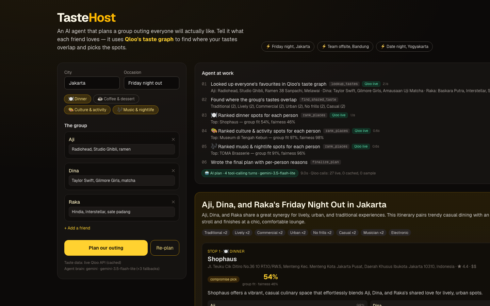
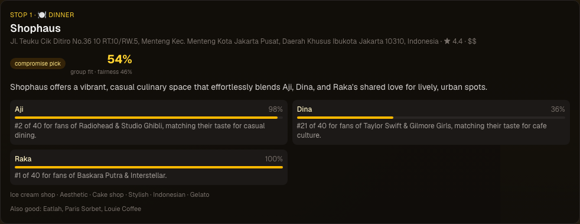
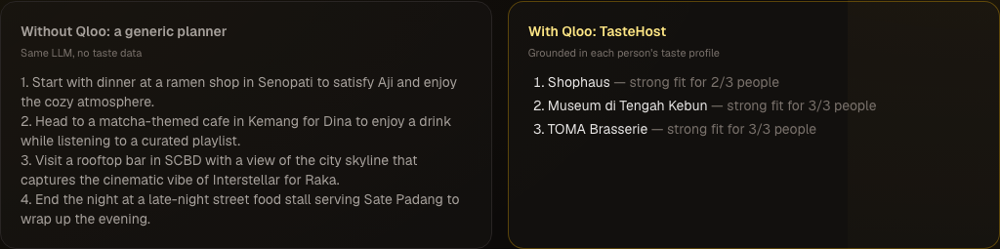

# TasteHost 🍽️🎨🎶

**An AI agent that plans a group outing everyone will actually like.**

**Live demo:** https://tastehost.vercel.app · Built for the [Qloo Agentic Hackathon](https://qloo.devpost.com) · MIT

Each friend lists a few things they love (artists, films, shows, food). TasteHost's agent looks them up in
[Qloo's](https://qloo.com) cross-domain taste graph, finds where the group's tastes overlap, ranks real places in your city
against *each person's* taste profile, and builds a plan that's fair to everyone, with a reason per person for every stop.
Someone changes their mind? Hit **Re-plan** and see what stays and what changes.



| Per-person reasons on every stop | Qloo vs. a generic LLM |
| --- | --- |
|  |  |

## Try it in 10 seconds

Click one of the **⚡ preset groups** (Friday night in Jakarta, team offsite in Bandung, date night in Yogyakarta).
Each preset loads the group and runs the agent in one click. Presets are pre-warmed, so they usually return a
**⚡ Cached AI plan** instantly. Click **run the agent live instead** to watch the full tool-calling loop.

## Why it needs Qloo

Without Qloo, an LLM plans "the famous landmark, the popular mall, a rooftop bar" for everyone. TasteHost shows this
side by side. The **Without Qloo** column is the same LLM with no taste data. The **With Qloo** column is grounded in
Qloo Insights, with each person's rank ("#2 of 40 for fans of Radiohead") plus a group-fit and fairness score for every stop.

## How it works

```
Browser ──POST /api/plan──▶ Next.js route (server only, streams NDJSON events)
                              │
                              ├─ Plan cache (sha256 of normalised group + city) → instant "Cached AI plan"
                              ├─ Agent loop (LLM tool-calling; deterministic planner if the LLM is busy/absent)
                              │    1. lookup_tastes      → Qloo /search        favourites → entity IDs + taste tags
                              │    2. find_shared_taste  → tag overlap across members
                              │    3. rank_places        → Qloo /v2/insights   filter.type=urn:entity:place,
                              │                             filter.location.query=<city>, filter.tags=<category>,
                              │                             signal.interests.entities=<IDs>
                              │                             1 group call + 1 call per member (top 40 each)
                              │                             + filter.results.entities affinity check for anyone left out
                              │    4. finalize_plan      → picks + per-member reasons, validated against tool data
                              └─ Generic baseline (same LLM, no tools) for the comparison panel
```

### Fairness, not just popularity

For each candidate place, every member gets a score from their own Qloo ranking.

```
groupScore = 0.4·avg + 0.4·min + 0.2·groupRank − 0.12·(members left out)
```

A member is **left out** if the place is in the bottom third of their list or missing from it. Places are sorted by
the number of members left out, then by score, so no one gets their last choice when a fairer option exists.
If nobody's lists overlap, the agent picks the best max-min compromise and labels it **compromise pick**.
Server-side guards stop the LLM from inventing place IDs, choosing an unfair stop when a fair one exists, or
claiming ranks: the "#N of 40" text always comes from Qloo data.

### Built for rate limits

- **Qloo client:** private server-side cache (fresh for 24h, stale for up to 30 days), 3 attempts with exponential
  backoff + jitter (honours `Retry-After`), limited concurrency, and a 12s timeout. Sample data is a last resort,
  and every step in the UI is labelled `Qloo live`, `Qloo cache`, or `sample data`.
- **LLM layer:** `LLM_MODEL` takes a comma-separated fallback list (default Gemini: `3.5-flash-lite → 3.5-flash →
  3.1-flash-lite → 3.6-flash`). The client retries on 404/408/429/5xx/timeout and keeps the last working model sticky.
- **Plan cache:** finished AI plans are cached by a hash of the normalised group, city, occasion and categories.
  `GET /api/warm` pre-warms the presets. If the LLM is rate-limited, the UI shows
  **"AI busy — showing the cached AI plan for this exact group"** or **"⚠️ AI busy · rule-based plan"**.
  The cache is private and runtime-only: Qloo-derived data is never committed to this repo.

| Badge | Meaning |
| --- | --- |
| 🤖 AI plan · N tool-calling turns · model | live LLM agent run |
| ⚡ Cached AI plan · made … | the same group's AI plan, served from the private cache |
| ⚠️ AI busy · rule-based plan | LLM unavailable; same Qloo tools, template explanations |

## Run locally

```bash
cp .env.example .env.local   # add QLOO_API_KEY (+ optional LLM key, e.g. GEMINI_API_KEY)
npm install
npm run dev                  # http://localhost:3000
node scripts/smoke.mjs jakarta http://localhost:3000            # or bandung | yogya, add --fresh to skip the cache
curl http://localhost:3000/api/warm                              # pre-warm the presets
```

## LLM providers

`src/lib/llm.ts` is provider-agnostic. It supports OpenAI-compatible chat completions (OpenAI, Groq, xAI, Gemini,
OpenRouter, or any `LLM_BASE_URL`) and Anthropic Messages. Without a key, the agent still runs the same Qloo tool
sequence and writes template explanations.

## Project structure

```
src/app/page.tsx              UI shell
src/components/Planner.tsx    presets, group editor, live agent trace, badges, plan cards, Qloo vs generic, re-plan
src/app/api/plan/route.ts     streaming agent endpoint (validation + simple rate limit)
src/app/api/warm/route.ts     pre-warms the preset plans into the private cache
src/app/api/status/route.ts   which data source / LLM is active
src/lib/agent.ts              tool definitions, agent loop, AI-busy fallback, plan caching
src/lib/planner.ts            Qloo-backed tools, fairness scoring, guards, explanations
src/lib/planCache.ts          plan cache keyed by a hash of the normalised group
src/lib/presets.ts            one-click demo groups
src/lib/qloo.ts               Qloo client (server-only): retries, backoff, cache, tag cleanup
src/lib/cache.ts              private server-side cache
src/lib/fallback.ts           hand-written sample data (only used when Qloo is unavailable)
src/lib/llm.ts                provider-agnostic LLM layer with tool calling and model fallback
scripts/smoke.mjs             CLI smoke test
docs/DEVPOST.md               hackathon write-up
```

## AI tools used

Built with AI coding assistants (Grok Bot / Claude). At runtime, the agent uses the configured LLM for tool calling.

## License

MIT © 2026 Riyan Aji Pangestu
