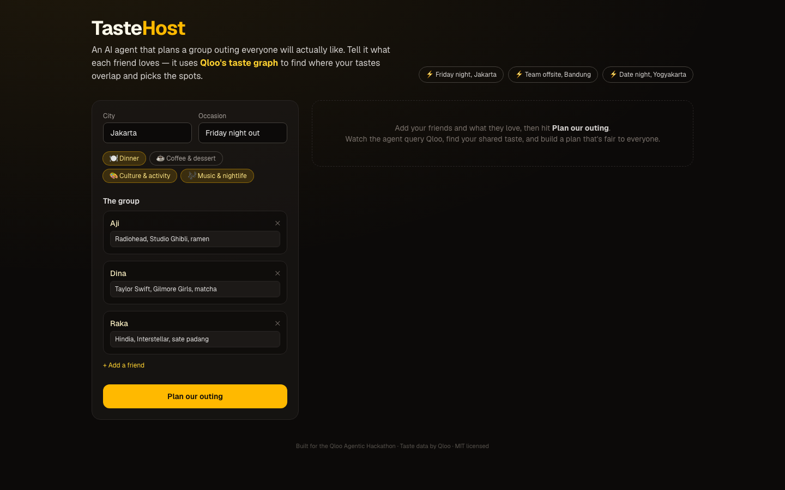
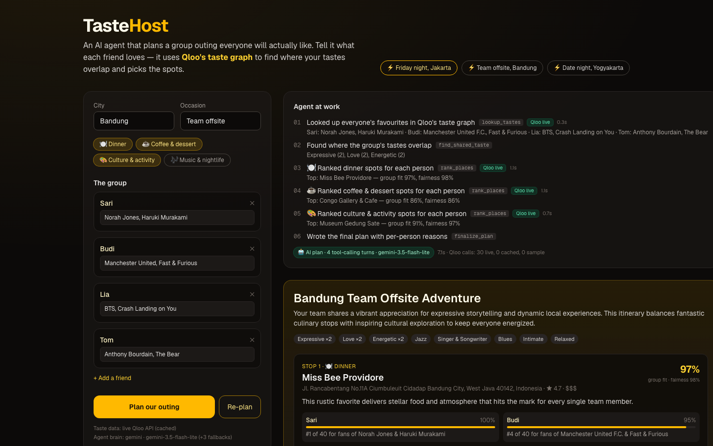
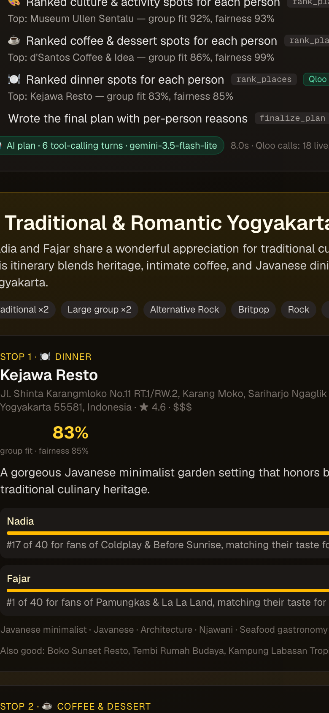

# TasteHost: Devpost write-up

> **Tagline:** An AI agent that plans a group outing everyone will actually like, powered by Qloo's taste graph.
>
> **Live demo:** https://tastehost.vercel.app · **Code:** https://github.com/ajip21hub/tastehost (MIT)

## Inspiration

Every group chat has the same problem. Someone asks "where should we go Friday?", five people reply "anything is fine",
and you end up at the same mall again. Even when it goes well, it's usually the loudest person's favourite spot.
Planning for a group means taking taste seriously: not just what's popular, but what *each* person would enjoy, and
making sure no one is quietly miserable. Qloo's cross-domain taste graph means we don't have to ask "what food do you
like?". Your friends can tell us they love Radiohead, Studio Ghibli or Gilmore Girls, and the agent can work out what
that means for dinner.

## What it does

1. Each friend lists a few things they love: artists, films, shows, books, dishes.
2. An AI agent calls tools in a visible loop:
   - **lookup_tastes** resolves every favourite to a Qloo entity (with taste tags) via Qloo Search.
   - **find_shared_taste** finds where the group's taste tags overlap.
   - **rank_places** asks Qloo Insights to rank real places in the city (dinner, coffee & dessert, culture,
     music & nightlife) once for the whole group and once for **each person**.
   - **finalize_plan** writes the itinerary with a reason per person for every stop, e.g. *"#2 of 40 for fans of
     Radiohead & Studio Ghibli"*.
3. Every stop shows a **group-fit score**, a **fairness score**, and a bar per person. If no place makes everyone
   happy, the agent picks the best compromise and labels it **compromise pick**.
4. A **"Without Qloo"** column shows what the same LLM suggests with no taste data, so you can see the difference.
5. **Re-plan** after someone changes their mind; the trace shows what stayed and what changed.
6. **One-click preset groups** (Jakarta, Bandung, Yogyakarta) let judges try it instantly.

## Why it's useless without Qloo

Take Qloo away and TasteHost is just an LLM guessing. It would suggest generic tourist spots (the comparison panel
shows exactly this) and couldn't say *why* a place suits a particular person. Everything that makes the plan good
comes from Qloo:

- **Cross-domain mapping:** "loves Hindia and Interstellar" becomes a ranked list of real Jakarta restaurants.
  Only a taste graph can connect music and film to places.
- **Per-person ranks:** fairness scoring needs each member's own ranking of the same places. Without it,
  "fair to everyone" is just a claim.
- **Shared taste tags:** the plan's theme ("Traditional ×2, Lively ×2") comes from the Qloo tags of the members' entities.
- **Grounding:** server-side guards reject any LLM pick that Qloo didn't return, and every "#N of 40" claim comes from Qloo data.

### Qloo endpoints used

| Endpoint | Parameters | Used for |
| --- | --- | --- |
| `GET /search` | `query`, `take` (+ a city-scoped re-search for local dishes and places) | resolve each favourite to a Qloo entity ID + tags |
| `GET /v2/insights` | `filter.type=urn:entity:place`, `filter.location.query=<city>`, `filter.tags=urn:tag:category:place:*`, `signal.interests.entities=<IDs>`, `take≤50` | rank places for the whole group and for each member (top 40) |
| `GET /v2/insights` | the same, plus `filter.results.entities=<candidate place IDs>` | affinity check: how close a candidate is for a member it isn't in the top 40 for |

All Qloo calls run server-side. The key never reaches the browser, and Qloo responses are cached privately on the server only.

## How we built it

- **Next.js 16** (App Router, TypeScript, Tailwind 4) on **Vercel**. One streaming route handler (`/api/plan`) sends
  NDJSON events so the UI can show the agent's steps live.
- **Agent loop** with OpenAI-style tool calling through a small provider-agnostic LLM layer
  (Gemini, OpenAI, Groq, xAI, OpenRouter, Anthropic). It has a comma-separated **model fallback chain**
  (Gemini 3.5 Flash-Lite → 3.5 Flash → 3.1 Flash-Lite → 3.6 Flash), retries, and a sticky "last model that worked".
- **Scoring:** `groupScore = 0.4·avg + 0.4·min + 0.2·groupRank − 0.12·(members left out)`. A member is "left out" if the
  place is in the bottom third of their list or missing from it. Places are sorted by how many people are left out
  first, so the best-scoring place never wins at someone's expense.
- **Guards:** a hallucination guard (only IDs returned by `rank_places`), a fairness guard (swap an unfair LLM
  pick for a fair alternative), and grounded per-person reasons.
- **Resilience:** Qloo retries with exponential backoff + jitter, honouring `Retry-After`; limited concurrency; a
  private server-side cache; a **plan cache** keyed by a hash of the normalised group; and `/api/warm` for presets.
  If the LLM is busy, the UI says so ("AI busy — showing the cached AI plan" or "rule-based plan") instead of failing.

## Challenges we ran into

- **Cross-domain search is ambiguous.** "Sate padang" matched restaurants in other countries, and "Manchester United"
  matched a restaurant. We now prefer non-place taste entities and re-search food and places inside the target city.
- **Tastes often don't overlap.** In our Jakarta demo, the three friends' top-40 dinner lists had *zero* places in
  common. Averaging scores picked places one person ranked last. We added the minimum-satisfaction ("left out") rule,
  plus an affinity check with `filter.results.entities`, so the agent can say "just outside their top 40" honestly.
- **Rate limits in a live demo.** Bursts of Qloo calls returned HTTP 429 and silently fell back to sample tags.
  Free-tier LLMs allow about 5 requests per minute per model. We fixed this with retries and backoff, lower
  concurrency, a model fallback chain, a plan cache, and a clear "AI busy" badge.
- **LLMs overclaim.** The model invented place IDs and ranks ("#21 of 40"). The server now validates every pick and
  writes the rank part of each reason itself.

## Accomplishments that we're proud of

- A real agent loop you can watch: 4–6 tool-calling turns and around 25–30 Qloo calls per plan, finished in under 10 seconds.
- Fairness you can see: per-person bars, ranks, and an honest "compromise pick" label.
- The "Without Qloo" comparison makes Qloo's value obvious in one screen.
- The demo still works when the LLM or Qloo is busy, and the UI always says which mode it's in.

## What we learned

- Taste data makes group planning a constraint problem. Max-min fairness matters more than average happiness.
- Qloo's cross-domain signals (music/film → places) are surprisingly strong, even for local places in Indonesian cities.
- Agents need guardrails between the LLM and the data. Let the model choose and explain; let the server keep it honest.
- Design for rate limits from day one: cache, back off, and show the user what's happening.

## What's next

- Shared links: each friend adds their own favourites from their phone, and the plan updates live.
- Time, budget and distance constraints, plus booking links.
- A shared, persistent plan cache (Vercel Runtime Cache / KV) instead of per-instance caches.
- More categories (outdoor, shopping) and multi-day trips.

## Built with

`qloo` · `qloo-insights-api` · `next.js` · `react` · `typescript` · `tailwindcss` · `vercel` · `gemini` ·
`llm-tool-calling` · `ai-agents` · `node.js`

## Testing instructions for judges

1. Open **https://tastehost.vercel.app**. No login needed.
2. Click a **⚡ preset** (e.g. "Friday night, Jakarta"). It loads the group and runs the agent in one click.
   - **⚡ Cached AI plan** means the preset's AI plan was pre-warmed. Click **run the agent live instead** to watch
     the live tool-calling loop (about 8–10 seconds).
   - **🤖 AI plan · N tool-calling turns** means a live LLM run.
   - **⚠️ AI busy · rule-based plan** means the free-tier LLM was rate-limited. The same Qloo tools ran with template
     explanations. Wait a minute and click **Re-plan** for an AI run.
3. Check the **Agent at work** trace (each step tagged `Qloo live` / `Qloo cache`), the per-person bars and reasons on
   each stop, and the **Without Qloo** comparison at the bottom.
4. Try your own group: change the city, edit the favourites (anything: bands, films, series, dishes), and click
   **Plan our outing**. Change one person's favourites and click **Re-plan** to see what changes.
5. `GET https://tastehost.vercel.app/api/status` shows the active data source and LLM.

Run it locally: see the [README](../README.md) (`npm install && npm run dev`, with `QLOO_API_KEY` and optionally `GEMINI_API_KEY`).

## Screenshots

| | |
| --- | --- |
|  |  |
|  |  |
|  |  |
